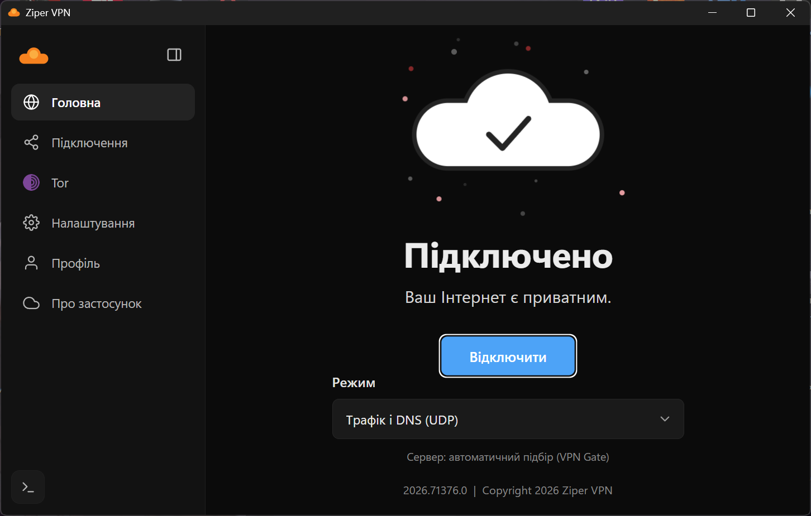
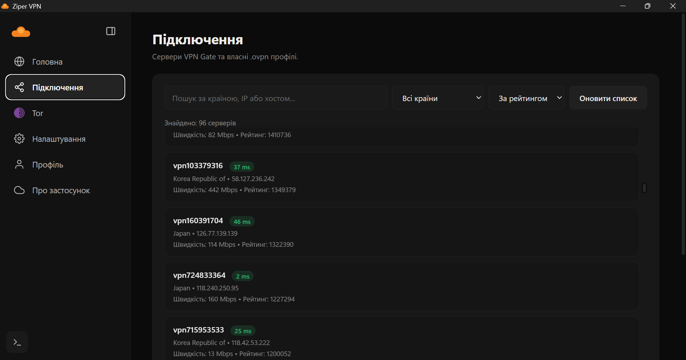
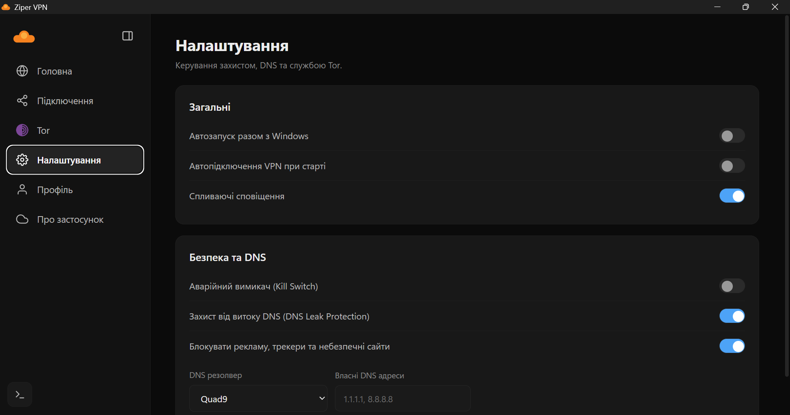
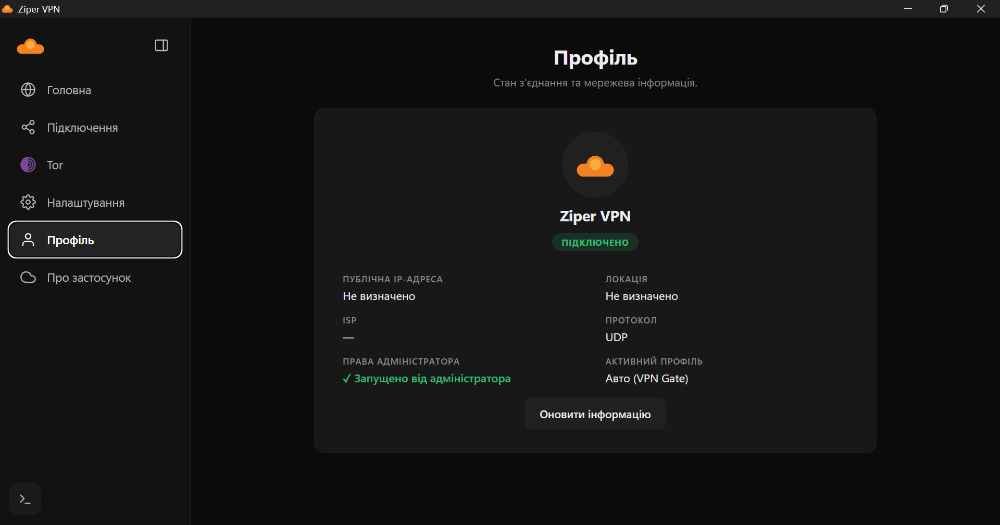
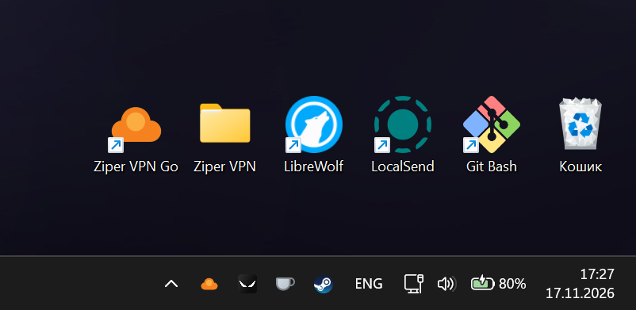

# Ziper VPN

<p align="center">
  
</p>

**Ziper VPN** — це навчально-практичний десктопний VPN-клієнт для Windows з відкритим вихідним кодом.
Застосунок поєднує підключення до публічних серверів дослідницької мережі VPN Gate, підтримку
власних OpenVPN-конфігурацій, локальний Tor SOCKS5-проксі та набір функцій приватності
(захист від витоку DNS, блокування реклами на рівні DNS, Kill Switch).

> ⚠️ **Дисклеймер.** Проєкт створено в освітніх цілях і надається «як є» (as is), без жодних
> гарантій. Автор не є афілійованим з VPN Gate, OpenVPN Inc., The Tor Project чи іншими
> сторонніми проєктами, згаданими нижче. Використовуйте програму відповідно до законодавства
> вашої країни та правил мереж, до яких підключаєтесь. Відповідальність за використання несе
> користувач.

---

## ✨ Можливості

- 🌍 **Автоматичний підбір серверів VPN Gate** — список активних серверів завантажується з публічного API, з фільтрацією за країною, пінгом та швидкістю
- 📄 **Власні `.ovpn` профілі** — імпорт власних конфігурацій OpenVPN, вони зберігаються між запусками
- 🧅 **Tor SOCKS5** — локальний проксі на `127.0.0.1:<порт>` з підтримкою власних мостів (obfs4 / snowflake / webtunnel / meek)
- 🛡 **Kill Switch** — брандмауер Windows блокує весь трафік поза тунелем, поки функція увімкнена
- 🚫 **Блокування реклами та трекерів на рівні DNS** — працює навіть без підключення VPN (AdGuard DNS)
- 🧭 **Вибір DNS-резолвера** — Quad9, Cloudflare, Google, AdGuard або власні адреси; застосовується системно
- 💧 **Захист від витоку DNS** — `block-outside-dns` під час активного тунелю
- 🔔 **Трей з індикаторами стану** — `○` відключено, `◐` підключення, `●` підключено (поруч із пунктами меню)
- 🗂 **Спливаючі сповіщення** — можна вимкнути у налаштуваннях (помилки показуються завжди)
- 🌐 **Журнал подій** — живі логи тунелю та Tor з копіюванням в буфер обміну

## 🖥 Інтерфейс

Вікно застосунку побудоване на Wails (Go + нативний WebView2) і має сторінки:
**Головна**, **Підключення**, **Tor**, **Налаштування**, **Профіль**, **Про застосунок**, **Журнал**.

| Підключення (сервери VPN Gate) | Tor SOCKS5 |
|---|---|
|  |  |

| Налаштування (безпека та DNS) | Профіль |
|---|---|
|  |  |

На сторінці «Профіль» видно публічну IP-адресу, локацію, ISP, протокол,
активний профіль та позначку «Запущено від адміністратора» / «Не запущено від імені адміністратора».

Значок у системному треї керує підключенням, Tor та .ovpn-профілями без відкриття вікна:

<p align="center">
  
</p>

## 📦 Вимоги

- Windows 10/11 (64-bit)
- Права адміністратора — потрібні для створення Wintun/TAP-адаптера, керування маршрутами,
  DNS та брандмауером. Застосунок сам запросить підвищення прав через UAC при старті.
- Інтернет-з'єднання — для завантаження списку серверів та інструментів, якщо їх немає поруч із exe.

## 🚀 Швидкий старт (готова збірка)

1. Завантажте останній архів зі сторінки [Releases](../../releases).
2. Розпакуйте папку та запустіть `ziper-vpn-go.exe`.
3. Підтвердьте UAC-запит і натисніть **Підключити**.

Поруч із exe програма створює:
- `config/settings.json` — налаштування,
- `config/profiles/*.ovpn` — ваші власні профілі,
- `openVPN/` — автоматично завантажені `openvpn.exe`, `wintun.dll` та драйвери (якщо їх немає поруч або в системі).

## 🛠 Збірка з вихідного коду

```bash
# встановіть Go 1.25+ та Wails CLI
go install github.com/wailsapp/wails/v2/cmd/wails@latest

# клонуйте репозиторій
git clone <посилання-на-ваш-форк>
cd ziper-vpn-go

# залежності фронтенду та збірка
cd frontend && npm install && cd ..

# режим розробки (гаряче перезавантаження)
wails dev

# фінальна збірка
wails build
# результат: build/bin/ziper-vpn-go.exe
```

## 🗃 Структура проєкту

```
├─ main.go                 # точка входу (UAC, вікно Wails, трей)
├─ app.go                  # бізнес-логіка, бінденги для фронтенду
├─ frontend/               # HTML/CSS/JS інтерфейс (Vite)
├─ internal/
│  ├─ vpn/                 # OpenVPN, Wintun/TAP, Management Interface, DNS
│  ├─ tor/                 # запуск Tor SOCKS5 та мостів
│  ├─ tray/                # значок і меню системного трея
│  ├─ settings/            # settings.json та зберігання профілів
│  ├─ win/                 # права адміністратора, UAC, реєстр, Kill Switch
│  └─ i18n/                # локалізація
└─ build/                  # іконки, ресурси, результат збірки
```

## 🔩 Як це працює (коротко)

1. Застосунок отримує список серверів з публічного API VPN Gate та декодує base64-конфіг OpenVPN.
2. Створюється Wintun-адаптер (fallback — TAP через tapctl), запускається `openvpn.exe`
   з Management Interface на `127.0.0.1:7505` для контролю стану (`WAIT → AUTH → CONNECTED`).
3. Після `CONNECTED` застосунок прописує обраний DNS на адаптер тунелю та (за потреби) на
   системні адаптери, вмикає Kill Switch через правила брандмауера Windows.
4. Tor запускається окремим процесом як SOCKS5-проксі; власні мости передаються при старті.

## ⚖️ Сторонні компоненти та їх ліцензії

Ziper VPN не містить копій вихідного коду цих проєктів — вони завантажуються як окремі
бінарні компоненти з офіційних джерел і розповсюджуються за власними ліцензіями:

| Компонент | Призначення | Джерело |
|---|---|---|
| [OpenVPN](https://openvpn.net) | тунель (GNU GPL v2; товарні знаки належать OpenVPN Inc.) | офіційний інсталятор / MSI |
| [Wintun](https://www.wintun.net) | мережевий драйвер тунелю | wintun.net |
| [VPN Gate](https://www.vpngate.net) | публічний список серверів (дослідницький проєкт Університету Цукуба) | публічний API |
| [Tor](https://www.torproject.org) | SOCKS5-проксі (3-clause BSD) | torproject.org |
| [Wails](https://wails.io) | фреймворк застосунку (MIT) | залежність Go |
| [systray](https://github.com/getlantern/systray) | значок трея (Apache-2.0) | залежність Go |

Назви OpenVPN, Tor, Wintun тощо є товарними знаками відповідних власників і згадані
лише для опису сумісності.

## 📜 Ліцензія цього проєкту

Вихідний код Ziper VPN поширюється за ліцензією **MIT** — дивіться файл `LICENSE`.
Ви можете вільно використовувати, змінювати та розповсюджувати код із збереженням
повідомлення про авторські права. Сторонні бінарні компоненти (таблиця вище) залишаються
під власними ліцензіями і не перекриваються MIT цього репозиторію.

## 🤝 Внесок

Pull request'и вітаються. Будь ласка, перед великою зміною відкрийте issue з описом ідеї.
Дотримуйтесь стилю коду проєкту та пишіть коментарі українською мовою, як решта коду.

---

*Ziper VPN — приватність, яку легко зрозуміти. Використовуйте з розумом.* 💙💛
